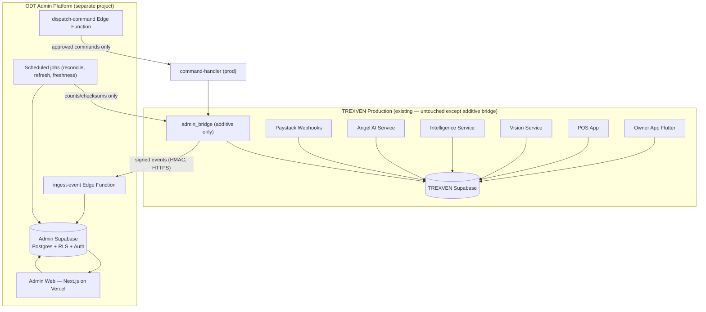
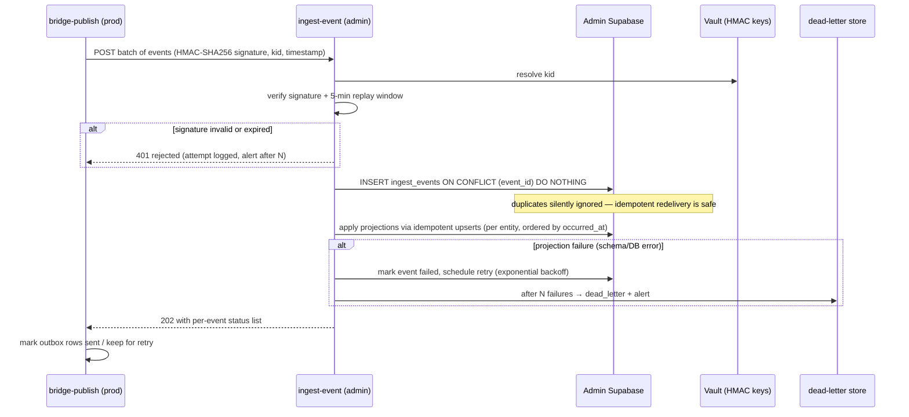
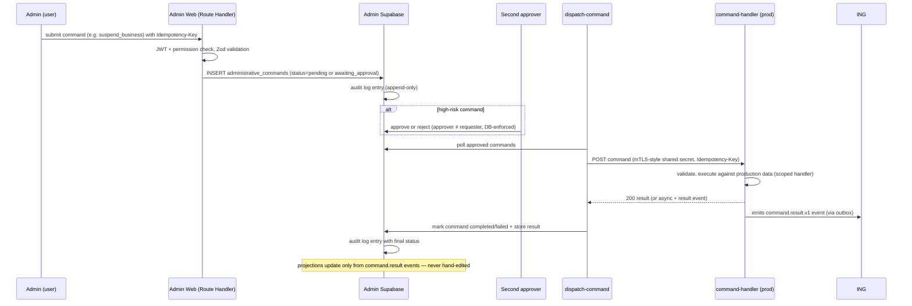
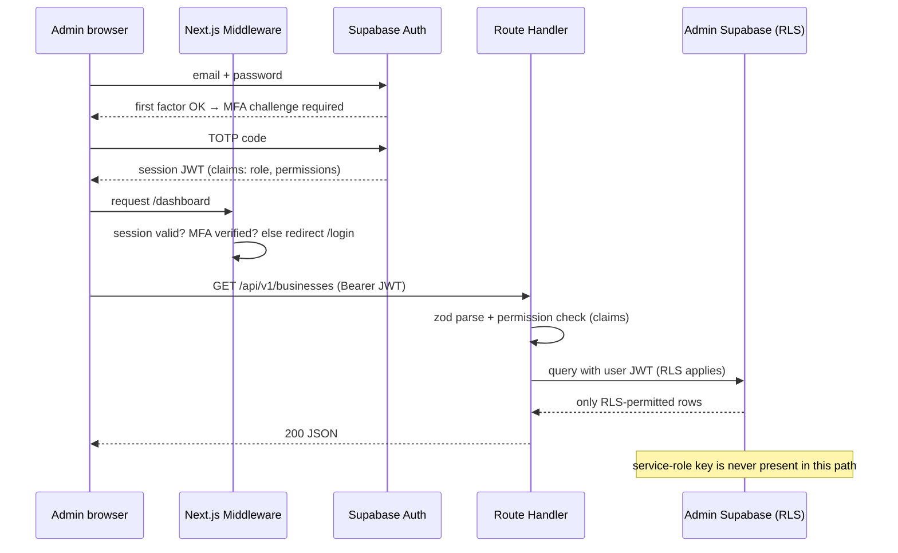
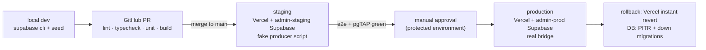

# 03 — System Architecture Diagrams

| Field | Value |
|---|---|
| Document | 03 — Architecture Diagrams |
| Version | 1.0 Baseline |
| Format | Mermaid (renders in GitHub / VS Code) |

## D1 — Ecosystem topology (high level)

**Reading notes:** the only arrows entering production are (a) approved commands and (b) reconciliation count queries. The only arrow leaving production is the signed event stream. `[UNVERIFIED]`: production table names feeding the bridge triggers.

## D2 — Event ingestion (happy path + failure path)

## D3 — Administrative command flow (production-affecting action)

## D4 — Authentication and authorization (request path)

## D5 — Environments and promotion

## Conventions for these diagrams

- Diagrams are authoritative for *flow shape*; schemas and contracts live in docs 08/10/11.
- Any production-side node name (`admin_bridge`, `command-handler`) is `[UNVERIFIED]` until the integration prerequisite checklist (doc 17 §7) is executed against the real TREXVEN backend.
- When adding products to the ecosystem, extend D1 with a new producer; do not add direct database links from the admin project to new product databases.