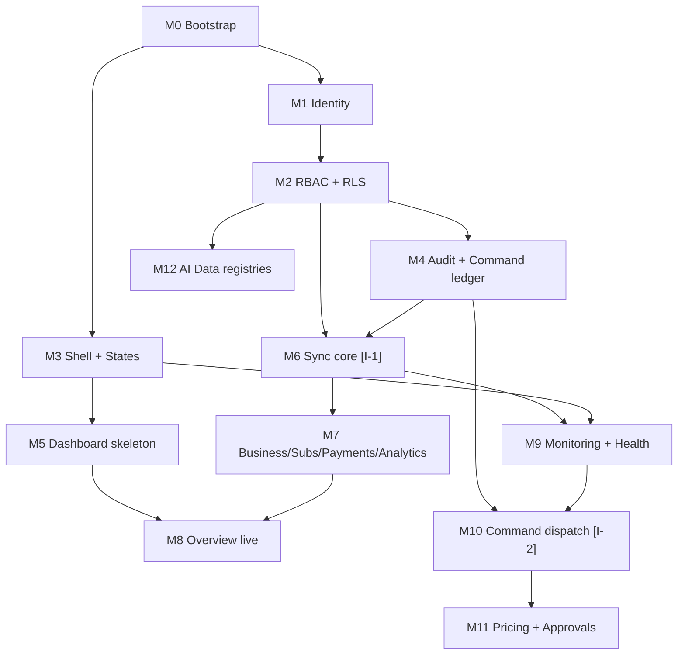

# 17 — Coding Handoff Document

| Field | Value |
|---|---|
| Document | 17 — Coding Handoff (for the implementing AI/engineers) |
| Version | 1.0 Baseline |
| Input | Docs 00–16 of this package |

## 1. How to use this document

1. Read `00-README.md` → `01` → `02` → `03` first; then follow the **build order** in §3.
2. Each milestone lists its specification sources and its **Definition of Done (DoD)**. Do not start a milestone before its dependency milestone's DoD is met.
3. Where the spec conflicts with observed reality (real TREXVEN backend), **stop**, write an ADR, update the relevant doc, and proceed — the docs are versioned with the code.
4. Every `[UNVERIFIED]` item maps to §7's checklist; execute those checks at the marked milestones, never silently assume.
5. The fake producer is your development backbone until the real bridge exists (doc 14 §6).

## 2. Non-negotiables (restated from 00 §3)

Separate Supabase project · one-way flow · no prod credentials in browsers · projections never hand-edited · commands only via the pipeline · never invent metrics · honest capability status · immutable audit · invite-only access · no CCTV/media access · no mock data presented as real.

## 3. Build order & milestones

| # | Milestone | Sources | DoD gate |
|---|---|---|---|
| M0 | Bootstrap: repo, scaffold, tokens, CI/CD, Supabase projects, fake producer skeleton | 14 §1–4, 05 §1–5 | `pnpm verify` green in CI; preview deploy works |
| M1 | Identity: Supabase Auth config, invite flow, TOTP MFA enforcement, sessions, middleware | 09 §1–3 | Login+MFA+logout e2e passes; open signup provably disabled |
| M2 | RBAC & RLS: tables, seeds, claims hook, policies, pgTAP suite | 09 §4–5, 08 §A, 13 §4 | Role-matrix pgTAP 100% green |
| M3 | Shell & states: sidebar/topbar/palette, all state components, 403 | 04 §1–3, 05 §6–8 | State gallery page renders all states in light+dark |
| M4 | Audit & command ledger: audit table + `write_audit()` + immutability, commands/approvals schema + registry | 08 §B, 09 §6–7 | pgTAP immutability + two-person rule green; denial attempts logged |
| M5 | Dashboard skeleton: metric registry seed, Overview with honest empty states | 01 §7, 04 §4.1, 08 §H | Overview renders with zero data — every card "awaiting sync" or "not instrumented" |
| M6 | Sync core: bridge schema+publisher (prod, additive) `[I-1]`, ingest-event, projections, aggregates, crons | 10, 08 §C–G | Duplicate-replay idempotency proof; reconcile matches counts |
| M7 | Business/Subscriptions/Payments/Product-Analytics modules | 04 §4.2–4.6, 11 §3–6 | doc 13 §6 scenarios 3, 6, 7, 9 pass |
| M8 | Overview live: freshness chips, deltas, series, ODT-vs-GMV separation | 01 §7, 05 §2 | Dashboard p95 < 500 ms; no invented values |
| M9 | Monitoring & health: sentry-ingest, error groups, sync health/DLQ, Vision/Angel/Intelligence pages, incidents | 12, 04 §4.7–4.11 | Bridge-kill drill shows stale+alerts; DLQ drains; capability banners verified |
| M10 | Command dispatch + production integration `[I-2]` | 07 §6–7, 09 §6 | Suspend→approve→verified effect→audit chain passes (mock, then real) |
| M11 | Pricing admin + approvals UX | 04 §4.15, 08 §B, 11 §4 | Pricing versioning + history + audit complete |
| M12 | AI data registries + governance | 08 §F, 04 §4.12 | Registry round-trip + FR-906 checks pass |

## 4. Module dependency graph

## 5. File organization during build

- Application tree: doc 06 §1 (authoritative).
- Add: `supabase/functions/*` per doc 07 §2 · `supabase/migrations/` sequential per doc 08 §12 · `tests/e2e/*` per doc 13 §6 · `docs/decisions/ADR-*.md` · `docs/runbooks/R-01…R-10.md`.
- Keep PRs small (~≤ 400 changed lines where practical); doc updates ship **in the same PR** as the behavior they describe.

## 6. Engineering conventions (summary)

Conventional Commits · CODEOWNERS on `supabase/**` and `src/lib/auth/**` · every schema change pairs with pgTAP · every API change pairs with Zod + regenerated `openapi.json` + doc 11 update · `capabilities` table is the only product-visibility flag source (no env feature flags) · UTC everywhere · no `any` (ESLint blocks).

## 7. Integration prerequisites checklist `[UNVERIFIED]`

Execute at the marked milestone; until verified, the dependent feature ships **disabled with honest states**.

| # | Prerequisite | Milestone | Evidence required |
|---|---|---|---|
| I-1.1 | TREXVEN backend owners approve additive `admin_bridge` schema + functions | M6 | Written sign-off (ADR) |
| I-1.2 | Real source table/column names for businesses, subscriptions, payments | M6 | Schema inspection notes |
| I-1.3 | Production Supabase plan supports Edge Functions + cron | M6 | Plan confirmation |
| I-1.4 | Paystack webhook reality: endpoint, signature scheme, event coverage | M7 | Webhook config + captured sample events |
| I-1.5 | Network path production → admin ingest (URL reachable, TLS) | M6 | First signed `202` response |
| I-2.1 | Production `command-handler` endpoint + pair-secret exchange agreed | M10 | Signed agreement + round-trip test |
| I-2.2 | Production-side validation rules for commands reviewed | M10 | Handler spec review |
| I-3.1 | Telemetry decisions for required app events (doc 10 §8) | any | Instrumentation plan |
| I-3.2 | Vision telemetry availability + format | M9 | Vision team confirmation |
| I-3.3 | Angel provider / cost data availability | M9 | AI team confirmation |

## 8. Explicitly out of scope now (do not build)

- AI training-job execution or orchestration (Phase 5 is registry/governance only)
- Refund execution; payment retries against providers
- Any CCTV media access (exceptional-access workflow is documentation-only, disabled)
- Public status page; native mobile admin apps; bulk administrative actions
- Historical production data migration beyond the event stream (backfill via pipeline covers gaps)

## 9. First-week quick start (for the coding assistant)

1. Scaffold per doc 06 §1 (M0 scope only) + tokens and state components (doc 05).
2. Local Supabase: migrations 0001–0004 (identity, RBAC seed, audit, command ledger) — RLS in every migration.
3. Wire invite → password + TOTP → session middleware (doc 09 §1–3).
4. Seed: roles, permissions, metric definitions (doc 01 §7), capabilities, command types.
5. CI green (`pnpm verify`, pgTAP, preview deploy). 6. Proceed M5 → M6 (request I-1 early — it has external lead time).